<a href="https://www.linkedin.com/in/tejas-sharma-896344328/">
  <picture>
    <source media="(prefers-color-scheme: dark)" srcset="assets/banner-dark.svg">
    
  </picture>
</a>

  
  
  
  

Hi, I'm **Tejas** — a full-stack developer and UI/UX designer from Haridwar, India, and co-founder of **[Osprexon](https://www.osprexon.com)**, a studio that builds websites, web apps, AI tools and chatbots for early-stage founders. I'm also a school student, so most of this was shipped between classes.

Every product I make starts in **Figma**: I design the full UI and flows first, then build it in code.

- 🏆 **Winner**, PEC International Hackathon by MLH (Chennai, 2025) — with VoicePal
- 🌏 **Finalist**, IEEE YESIST12 2026, Junior Einstein Track (Indonesia) — with VoicePal
- 🚀 **Galactic Problem Solver**, NASA Space Apps Challenge 2025 — with BioNex
- 🌱 **Winner**, CBSE Skill Expo Nationals — with VrikshMitra
- ✍️ **Writing code since** 2021, starting with a [quiz website](https://github.com/tejassharmax/quiz)

 

## Featured: Ayusha Health

<a href="https://ayushahealth.in">
  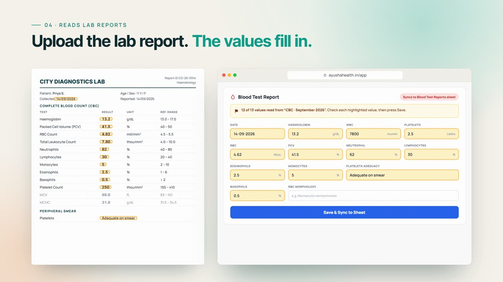
</a>

**A health record system for children's homes in India.** Every child gets one profile with their checkups, growth, blood tests, vaccinations and documents, and all of it stays in sync with the home's own Google Sheets, Drive and Calendar. Staff keep working in the spreadsheets they already know; the app does the rest.

- **Reads lab reports.** Upload a PDF or a photo and the values fill in. PDFs are read exactly with pdf.js; photos run Tesseract OCR on the device, so the report never leaves the browser.
- **Checked, never guessed.** Differentials must add up to 100%, Hb / PCV / MCHC must agree, blurry photos are refused and unsure digits are left blank.
- **Two-way Google sync.** One tab per child in Sheets, one Drive folder per child, appointments on Calendar. Edits made in Sheets come back into the app.
- **Built for inspections.** A Date Range Report pulls every checkup in a period into one printable view.
- **Private by design.** Staff-only Google sign-in with an allow-list, one space per home, data stored in India (Firestore, Mumbai).

  <a href="https://ayushahealth.in"><b>Live site</b></a> &nbsp;·&nbsp;
  <a href="https://github.com/tejassharmax/NGO"><b>Source code</b></a> &nbsp;·&nbsp;
  Presented at Drishti by Empowered Margins

<picture>
  <source media="(prefers-color-scheme: dark)" srcset="assets/impact-dark.svg">
  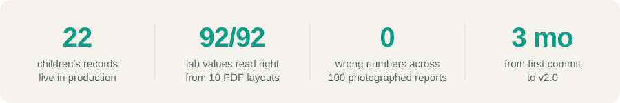
</picture>

 

## More things I've built

<table>
  <tr>
    <td width="96"><a href="https://voicepal-pec.netlify.app">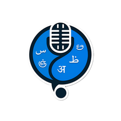</a></td>
    <td><b><a href="https://voicepal-pec.netlify.app">VoicePal</a></b> — AI speech therapy platform that identifies stammering, cluttering and childhood apraxia, with personalised exercises. Winner, PEC International Hackathon (MLH) · Finalist, IEEE YESIST12 2026 · JavaScript, Firebase, Gemini API, GSAP</td>
  </tr>
  <tr>
    <td>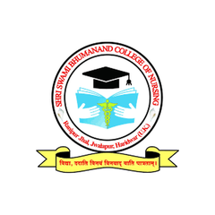</td>
    <td><b>SBNC Admin</b> — student and fee management for a nursing college in Haridwar: Excel import with review, a permanent fee ledger, and automatic email reminders with a payment QR. In production · private repo · Firebase, Node.js, Nodemailer, ExcelJS</td>
  </tr>
  <tr>
    <td><a href="https://druva.netlify.app">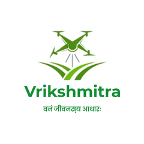</a></td>
    <td><b><a href="https://druva.netlify.app">VrikshMitra</a></b> — reforestation drone with a web dashboard for site selection and forest-fire monitoring. CBSE Skill Expo Nationals winner · WRO Regionals 2nd prize · ₹35,000 USERC funding · Leaflet, Firebase, Chart.js, Python</td>
  </tr>
  <tr>
    <td><a href="https://herbalens.netlify.app">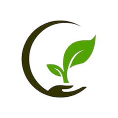</a></td>
    <td><b><a href="https://herbalens.netlify.app">HerbaLens</a></b> — snap a photo to identify a medicinal plant, plus an Ayurvedic remedy library and a virtual garden. ₹25,000 hackathon win, Uttaranchal University · Intel AI Impact Festival</td>
  </tr>
  <tr>
    <td><a href="https://bionexspace.netlify.app"><b>🚀</b></a></td>
    <td><b><a href="https://bionexspace.netlify.app">BioNex</a></b> — AI-powered explorer for 600+ NASA space-bioscience studies: summaries, search and insights. Built for NASA Space Apps Challenge 2025 · Firebase, Gemini API</td>
  </tr>
  <tr>
    <td><a href="https://owalker.netlify.app">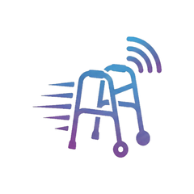</a></td>
    <td><b><a href="https://owalker.netlify.app">Obedient Walker</a></b> — ESP32-powered smart walker for specially-abled users that follows a transmitter and streams stats to a dashboard. CBSE Skill Expo 2025 nationals · INSPIRE-MANAK funded · ESP32, Arduino (C++), Bluetooth LE</td>
  </tr>
  <tr>
    <td>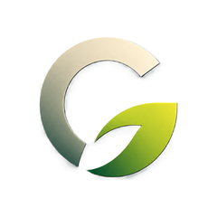</td>
    <td><b>CarbonLens</b> — AI emissions tracking for schools and communities, with a guided greenhouse-gas assessment and Gemini-powered recommendations. JavaScript, Firebase, Gemini API, Chart.js</td>
  </tr>
  <tr>
    <td><a href="https://davhacklab-github-io.onrender.com">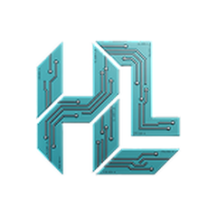</a></td>
    <td><b><a href="https://davhacklab-github-io.onrender.com">DAV HackLab</a></b> — platform for the free student coding community I run at school: learning paths, articles, projects and events. Vite, GSAP, Three.js, Node.js, Express, Firebase Auth, Astra DB</td>
  </tr>
  <tr>
    <td><b>🎬</b></td>
    <td><b>Wobble</b> — a motion design studio that runs in the browser: animate layers on a timeline and export video, GIFs or frames. React, TypeScript, Zustand, Vite</td>
  </tr>
</table>

Plus client work at Osprexon — [osprexon.com](https://www.osprexon.com), Kamal Engineers And Packagings, Prime Pack and Empowered Margins — and Chrome extensions with 3,000+ active users.

 

## Tools I design and build with

<picture>
  <source media="(prefers-color-scheme: dark)" srcset="assets/stack-dark.svg">
  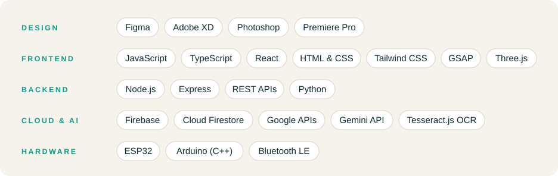
</picture>

 

## Activity

<picture>
  <source media="(prefers-color-scheme: dark)" srcset="https://raw.githubusercontent.com/tejassharmax/tejassharmax/output/snake-dark.svg">
  
</picture>

 

## Let's talk

Open to collaborations, freelance builds and hackathon teams.
Reach me on [LinkedIn](https://www.linkedin.com/in/tejas-sharma-896344328/), through [Osprexon](https://www.osprexon.com), or by [email](mailto:tejassachin2010@gmail.com).

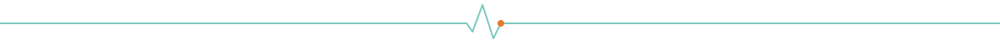
